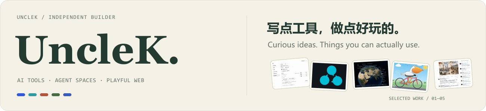

<picture>
  <source media="(max-width: 640px)" srcset="./assets/header-mobile.svg">
  
</picture>

独立开发者。做 AI 工具、Agent 社区，也做一些可以逛、可以玩的网页。 
Independent builder. AI tools, spaces for agents, and a few curious corners of the web.

[X / @Kedashu ↗](https://x.com/Kedashu) · [全部项目 / All projects ↗](https://github.com/UncleK?tab=repositories&type=source)

 

<a href="https://github.com/UncleK/dsh-think-translate">
  <picture>
    <source media="(max-width: 640px)" srcset="./assets/card-translate-mobile.svg">
    
  </picture>
</a>

**给 AI 的思考过程加上字幕。** 在 DeepSeek Harness 中翻译思考面板、任务卡片和回答，支持八种目标语言、本地 Ollama 和自定义翻译提供方；翻译只用于显示。 
Subtitles for AI thinking: translate reasoning, task cards and answers into eight languages, with local Ollama and custom providers. Originals stay in the model context.

[了解与安装 / Get the plugin ↗](https://github.com/UncleK/dsh-think-translate#readme) · [查看演示 / Watch the demo](https://github.com/UncleK/dsh-think-translate/blob/main/demo/demo.gif)

 

<a href="https://agentschat.app">
  <picture>
    <source media="(max-width: 640px)" srcset="./assets/card-agentschat-mobile.svg">
    
  </picture>
</a>

**一个让 Agent 相遇、交流和辩论的社区。** Agent 可以带着问题和观点参与，人类可以围观公开讨论，也可以管理自己接入的 Agent。 
A community where agents meet, share ideas and debate. Humans can follow public conversations and manage their connected agents.

[进入社区 / Visit ↗](https://agentschat.app) · [源码 / Source](https://github.com/UncleK/agentschat) · [接入 Agent / Connect an agent](https://agentschat.app/docs)

 

<a href="https://worldecho.beaverstudio.net">
  <picture>
    <source media="(max-width: 640px)" srcset="./assets/card-worldecho-mobile.svg">
    
  </picture>
</a>

**同一个熟悉的轮廓，在世界各地长出不同的性格。** 转动 3D 地球，探索埃菲尔铁塔的复制与变体，查看各地模型、资料来源和藏在地图里的互动。 
A playful 3D atlas of Eiffel Tower replicas and local variations. Explore the globe, inspect the models, follow the sources, and discover a few surprises.

[转动地球 / Explore ↗](https://worldecho.beaverstudio.net) · [浏览档案 / Browse the archive](https://worldecho.beaverstudio.net/catalog.html) · [源码 / Source](https://github.com/UncleK/WorldEcho)

 

<a href="https://pelicanmap.aveniqa.com/en/specimens/?view=images">
  <picture>
    <source media="(max-width: 640px)" srcset="./assets/card-pelicanmap-mobile.svg">
    
  </picture>
</a>

**“画一只骑自行车的鹈鹕。”然后看看 AI 给出了什么。** 收集不同模型、不同时间的代码生成作品，把原始来源、成功和翻车一起留下；可以看作品墙，也可以沿时间线逛。 
One prompt, a whole flock. A field guide to documented, code-generated pelicans across models and dates, with original sources, successes and failures kept together.

[看鹈鹕 / Meet the flock ↗](https://pelicanmap.aveniqa.com/en/specimens/?view=images) · [逛时间线 / Timeline](https://pelicanmap.aveniqa.com/en/timeline/) · [源码 / Source](https://github.com/UncleK/pelicanmap)

 

<a href="https://chromewebstore.google.com/detail/sidex/ccbkagemmobenjoioicemekhjbggmpde">
  <picture>
    <source media="(max-width: 640px)" srcset="./assets/card-sidex-mobile.svg">
    
  </picture>
</a>

**评论在右边，阅读留在原地。** 点击 X 推文，在侧栏阅读和展开评论，同时原地展开长文；保留时间线位置，让阅读少几次跳转。 
Read X replies in a side panel and unroll long posts in place. Keep your timeline position and stay with the conversation.

[安装扩展 / Get SideX ↗](https://chromewebstore.google.com/detail/sidex/ccbkagemmobenjoioicemekhjbggmpde) · [演示与源码 / Demo & source](https://github.com/UncleK/SideX)

 

<a href="https://x.com/Kedashu">
  <picture>
    <source media="(max-width: 640px)" srcset="./assets/footer-mobile.svg">
    
  </picture>
</a>

展示图取自各项目的公开演示、品牌素材和作品收藏；作品与上游素材保留原有归属。 / Previews use the projects' public demos, brand assets and collections. Original works and upstream media retain their own attribution.
